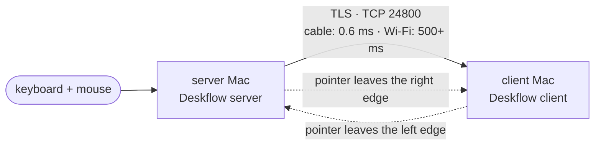

# share-mouse-keyboard-between-macs

**Use one Mac's keyboard and mouse on a second Mac with Deskflow 1.27, without Universal Control.
Verified setup, scripts that do every check for you, and a Claude Code skill that does it end to end.**

Universal Control is Apple's built-in way to share a keyboard and mouse across Macs. It needs both Macs on
one Apple ID **with two-factor authentication turned on**, plus Handoff, Bluetooth and iCloud cooperating. When
any of that is missing, [Deskflow](https://github.com/deskflow/deskflow) is the free, open-source answer. It is
the upstream of Synergy and the successor of Barrier and Input Leap. One Mac (the **server**) owns the keyboard
and mouse. Push the pointer off its screen edge and it appears on the other Mac (the **client**), with the keyboard
and clipboard following.

This repository is the setup as it was actually done and verified on an iMac and a MacBook Pro in November 2026.
It covers the 1.27 settings format that the guides you will find elsewhere predate, the macOS permissions that
fail silently, and a Wi-Fi lag that made the first working setup unusable, measured and then removed with one
cable.



> **Status:** verified with Deskflow **1.27.0** on macOS 26.6 (Apple Silicon, server) and macOS 15.8 (Intel,
> client). Deskflow changed its settings format in this line of releases. Run `check-deskflow.sh` (below) on
> your own build instead of trusting any file layout, including the one described here.

---

## Quick start

Run on **each** Mac, from a clone of this repository:

```bash
S=skills/deskflow-two-macs/scripts

# 1. Download, verify (SHA-256, notarization, signing team) and install Deskflow
$S/install-deskflow.sh                 # expect "Installed deskflow-core v1.27.0"

# 2. Write the settings before the first launch, so nothing has to be picked in the app
#    on the Mac that has the keyboard and mouse:
$S/write-deskflow-config.py server --name imac --client macbook --side right
#    on the other Mac (use the server's address; see "Wired link" for why it should be a cable):
$S/write-deskflow-config.py client --name macbook --server 192.168.77.1

# 3. Start it, then grant what macOS asks for (see "Permissions")
open -a Deskflow

# 4. Check it
$S/check-deskflow.sh                   # expect "VERDICT: OK"
```

The two names are labels inside Deskflow, not host names. Each must match on both sides: the server's layout says
`macbook` sits to the right of `imac`, so the client must call itself `macbook`.

**Permissions.** macOS gates each of these separately, and none of them fails loudly:

| Mac | Permission | Where | What happens without it |
| --- | --- | --- | --- |
| both | Accessibility | System Settings → Privacy & Security → Accessibility | the app quits at once with exit code 1 |
| server | Input Monitoring, if prompted | Privacy & Security → Input Monitoring | the pointer cannot be captured at the edge |
| client (macOS 15+) | Local Network | Privacy & Security → Local Network | connections hang in `SYN_SENT`, while `curl` from Terminal works fine |

On the first connection, each side shows the other's TLS fingerprint once. Compare it with
`check-deskflow.sh` on the other Mac before you accept it.

---

## Wired link: do this if the pointer lags

Deskflow sends every pointer movement as a small packet from server to client. On a quiet network that takes a
few milliseconds. On the network this was built on, it took **500 to 2,800 ms**: the client's pointer trailed
by seconds. Deskflow, the CPU and the VPN were all ruled out. Both Macs had high latency to the router itself, and
the server's radio was releasing held packets in bursts about once a second.
[The full diagnosis](reports/2026-11-14-wifi-lag/README.md) has the numbers.

A direct cable between the two Macs takes Wi-Fi out of the path. Internet still goes over Wi-Fi.

| Cable | Needs | Measured |
| --- | --- | --- |
| Ethernet, Mac to Mac | an Ethernet port or a USB-C Gigabit adapter on each side | **0.6 ms** average, 0.9 ms max |
| Thunderbolt Bridge | a **Thunderbolt 3/4 or USB4** cable (⚡ or "40" on the plug) | not measured here; a USB-C charging cable shows "No device connected" on both Macs |

Then give each end a fixed address on a private `/24` that nothing else on either Mac uses, and point the client
at the server's address. [The wired-link guide](skills/deskflow-two-macs/references/wired-link.md) has the commands and the checks.

```bash
$S/measure-latency.sh 192.168.77.2     # from the server: expect under 1 ms over the cable
```

---

## Use it as a Claude Code skill

The [`deskflow-two-macs`](skills/deskflow-two-macs/SKILL.md) skill walks Claude through all of the above. It runs
the scripts, stops for the clicks only a person can make, and reads the logs when something fails.

```text
/plugin marketplace add aliyzl/share-mouse-keyboard-between-macs
/plugin install deskflow-two-macs@share-mouse-keyboard-between-macs
```

Or copy the one folder: `cp -R skills/deskflow-two-macs ~/.claude/skills/`. Then ask Claude to share this Mac's
keyboard and mouse with your other Mac.

**Two Macs, two Claude sessions.** The original setup ran one Claude Code session on each Mac, talking through
[`tools/claude-mailbox`](tools/claude-mailbox/README.md). It is a 120-line, standard-library HTTP mailbox, with a
live page so the person can watch the two sessions agree. It needs no install on the second Mac, only `curl`.

---

## What is in here

| Path | What it holds |
| --- | --- |
| [`setup/`](setup/README.md) | the manual, step-by-step guide for both Macs, with expected output |
| [`skills/deskflow-two-macs/`](skills/deskflow-two-macs/SKILL.md) | the Claude Code skill, the scripts, and the references: [settings format](skills/deskflow-two-macs/references/settings-format.md), [wired link](skills/deskflow-two-macs/references/wired-link.md), [troubleshooting](skills/deskflow-two-macs/references/troubleshooting.md) |
| [`reports/2026-11-14-wifi-lag/`](reports/2026-11-14-wifi-lag/README.md) | how the lag was measured and pinned down, with the evidence |
| [`WHAT-WENT-WRONG.md`](WHAT-WENT-WRONG.md) | every mistake made on the way, what it cost, and the rule that now prevents it |
| [`tools/`](tools/README.md) | the two-session mailbox and the repository's own secret scan |
| [`THIRD-PARTY.md`](THIRD-PARTY.md) | Deskflow's licence and the exact release that was verified |

---

## Gotchas

The full list, with log lines, is in [troubleshooting](skills/deskflow-two-macs/references/troubleshooting.md). These are the ones
that cost the most:

1. **`section: screens` is ignored in 1.27.** The log says *"Screens have moved to the general config"*, and the
   server exits with code 4 and *"unknown computer name"*. Each computer is now a `[computer_<name>]` group with
   `name=<name>` in `~/Library/Deskflow/Deskflow.conf`. `write-deskflow-config.py` writes these groups.
2. **The DMG has a licence agreement.** In a script, `hdiutil attach` prints `attach canceled`. Pipe `yes` into it,
   and turn off `pipefail` for that line, or `yes` dies of SIGPIPE and takes the script with it.
3. **Do not start `deskflow-core` from a terminal.** macOS charges the Accessibility check to the terminal, and
   the core exits with *"assistive devices does not trust this process"*. Start the app with `open -a Deskflow`.
4. **`osascript -e 'quit app "Deskflow"'` is refused**, and the app lives on in the menu bar. Use `kill -TERM` on
   both processes. Note that `pgrep -f deskflow` misses the GUI, whose binary is `Deskflow`.
5. **`failed to accept secure socket` every few seconds** means something is opening TCP 24800 without TLS: a
   port probe such as `nc -z`, or an old Barrier client that is still running. It is not your Deskflow client.
6. **`saying hello as Barrier, protocol v1.8` is normal.** In 1.27 the default network protocol is Barrier's.
7. **A Wi-Fi scan spoils latency numbers.** `system_profiler SPAirPortDataType` takes the radio off its channel.
   Measure first and scan afterwards.

---

## When not to do this

- **If both Macs can use Universal Control, use it.** It needs no install, and Apple keeps it working across
  macOS updates.
- **Over a network you do not control.** Deskflow's TLS protects the traffic, but anyone who can reach TCP 24800
  can try to connect. Keep fingerprint checking on, which is the default.
- **If you cannot run a cable and your Wi-Fi is slow to the router.** Test with `measure-latency.sh` first. If the
  router itself is above about 20 ms, no keyboard-sharing tool will feel right over that network.

## Compatibility

| | Verified on |
| --- | --- |
| Server | iMac 24-inch (M1, 2021), macOS 26.6, Deskflow 1.27.0 `macos-arm64` |
| Client | MacBook Pro 15-inch (2018, Intel), macOS 15.8, Deskflow 1.27.0 `macos-x86_64` |
| Link | direct Gigabit Ethernet (the MacBook through a USB-C adapter). Before that, 2.4 GHz 802.11n Wi-Fi, which worked but lagged |
| Claude Code | skills and plugin marketplace as documented in November 2026 |

## Contributing

Issues and pull requests are welcome, especially results from other Mac models and Deskflow versions. Paste the
output of `check-deskflow.sh` (it prints no secrets) and of `measure-latency.sh` from both Macs.

## License

MIT for everything in this repository: see [LICENSE](LICENSE). Deskflow itself is GPL-2.0 and is downloaded from
its own releases, never redistributed here: see [THIRD-PARTY.md](THIRD-PARTY.md).
